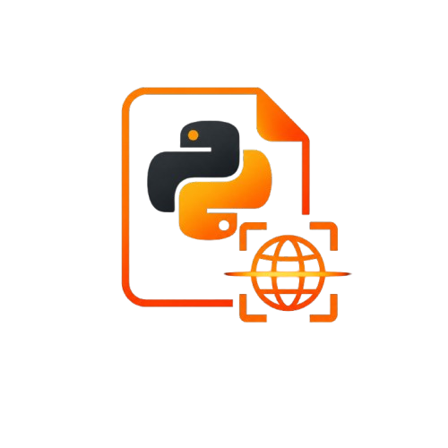

 <div align="center">



# 🟠 REDMI — Python Website Scanner

```text
██████╗ ███████╗██████╗ ███╗   ███╗██╗
██╔══██╗██╔════╝██╔══██╗████╗ ████║██║
██████╔╝█████╗  ██║  ██║██╔████╔██║██║
██╔══██╗██╔══╝  ██║  ██║██║╚██╔╝██║██║
██║  ██║███████╗██████╔╝██║ ╚═╝ ██║██║
╚═╝  ╚═╝╚══════╝╚═════╝ ╚═╝     ╚═╝╚═╝

       [ PYTHON WEBSITE SCANNER ]
       [ WEB SECURITY RECON TOOL ]

       STATUS: UNDER DEVELOPMENT
```

> A Python-based website scanner built to learn HTTP, website security checks, and Python development.

## 🟠 About

**REDMI** is a personal Python project designed to inspect website responses and display useful technical information in the terminal.

The project is also a practical way to learn Python libraries, HTTP requests, response headers, error handling, and terminal interface design.

## ⚡ Features

- HTTP response status codes
- Response time measurement
- HTTP response headers inspection
- Basic security header checks
- Connection error handling
- Colored terminal output using Rich
- Custom cybersecurity-themed terminal interface

## 🛠️ Built With

- **Python** — Main programming language
- **Requests** — Sending HTTP requests
- **Rich** — Terminal styling and colored output

## 📁 Project Structure

```text
REDMI/
│
├── main.py
├── ui.py
├── theme.py
├── README.md
│
└── requirements.txt
```

*The file structure may change as development continues.*

## 🚀 Getting Started

### 1. Clone the repository

```bash
git clone YOUR_REPOSITORY_URL
```

### 2. Enter the project directory

```bash
cd REDMI
```

### 3. Install dependencies

```bash
pip install -r requirements.txt
```

### 4. Run the scanner

```bash
python main.py
```

## 🔍 Security Checks

REDMI focuses on basic website inspection, including:

- HTTP security headers
- Server response information
- Connection failures and timeouts
- Basic response analysis

**Important:** Missing security headers do not automatically mean a website is vulnerable. The scanner provides basic indicators, not a complete security audit.

## 🎯 Project Goals

- Improve my Python programming skills.
- Understand how HTTP requests and responses work.
- Learn how to inspect website security configurations.
- Practice using external Python libraries.
- Build a custom terminal interface.
- Develop the project step by step without blindly copying code.

## ⚠️ Disclaimer

This project is intended for educational purposes and authorized security testing only.

Only scan websites you own or have explicit permission to test.

## 📌 Project Status

**Under Development**

New features and improvements will be added as I continue learning Python and web security.

---

*Learn by building. Understand before automating.*

